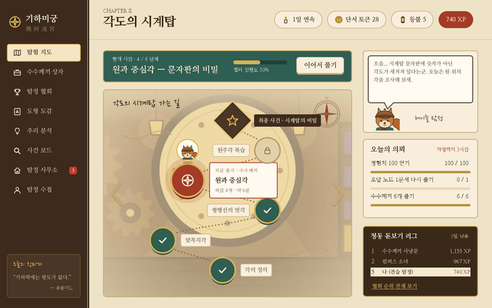
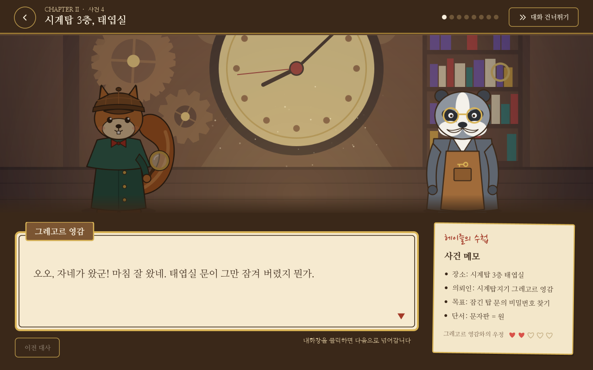
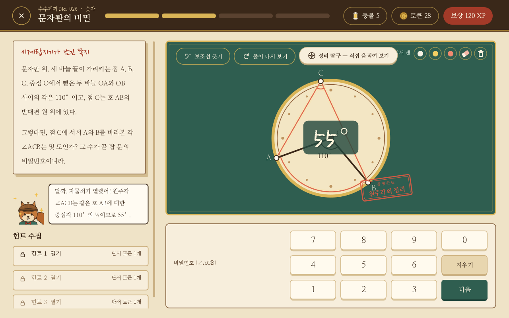
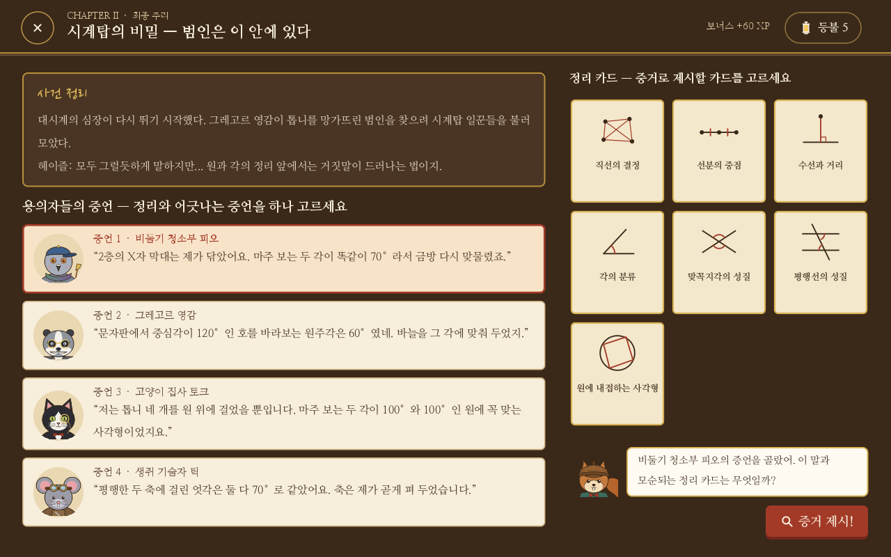
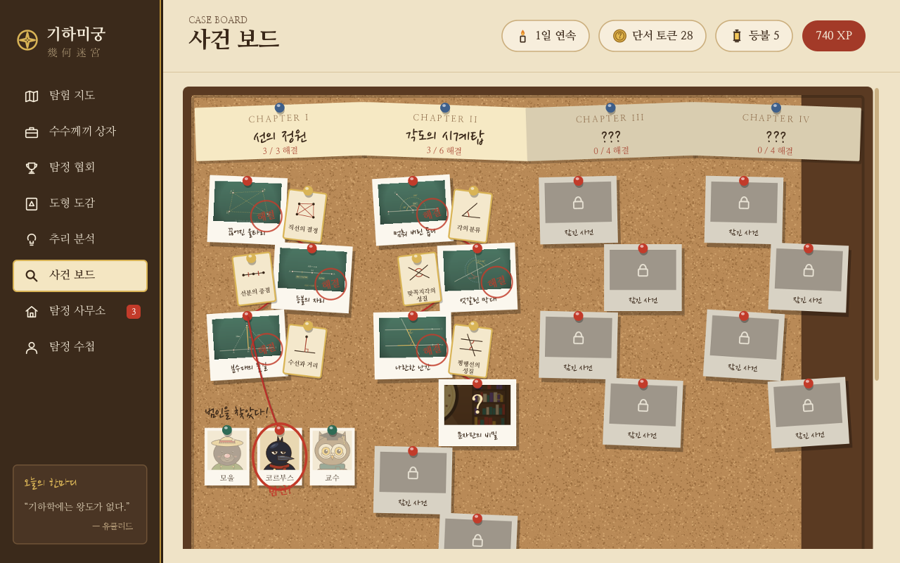
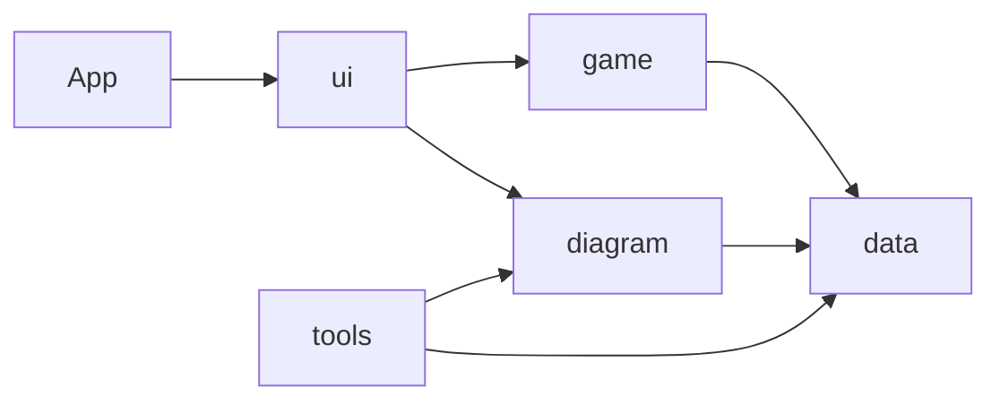

# 기하미궁 (幾何迷宮)

선, 각, 삼각형, 원의 성질을 탐정 게임으로 배우는 Java Swing 데스크톱 앱입니다.
객체지향 프로그래밍 팀 프로젝트로 만들었습니다.

견습 탐정 헤이즐이 되어 사건을 맡습니다. 의뢰인의 이야기를 듣고, 현장에 남은 도형 수수께끼를 풀어 사건을 해결합니다.
각 장의 마지막 사건에서는 용의자 증언 중 정리와 맞지 않는 말을 찾아 정리 카드로 반박하고 범인을 밝힙니다.

게임은 네 개의 장(선의 정원, 각도의 시계탑, 삼각형의 수도원, 원의 천문대)으로 되어 있습니다.
사건 17개, 수수께끼 70개, 정리 카드 17장이 들어 있습니다.



## 실행

JDK 11 이상이 필요합니다. 따로 설치할 라이브러리는 없습니다.

```sh
./run.sh            # 게임
./run.sh validate   # data/*.csv 검사 (오류가 있으면 종료 코드 1)
./run.sh editor     # 도형 편집기
```

IntelliJ에서는 작업 폴더를 프로젝트 루트로 두고 `geomystery.App`을 실행하면 됩니다.

## 플레이 흐름

1. **탐험 지도**에서 사건을 고릅니다.
2. **도입 대화**에서 의뢰인에게 사건 이야기를 듣습니다.
3. **수수께끼**를 풉니다. 문제는 숫자, 보기, 식, 참/거짓, 추리 순서 맞추기 다섯 가지입니다.
   틀리면 등불(하트)이 하나 꺼지고, 어떤 실수를 했는지 알려 줍니다. 단서 토큰으로 힌트를 볼 수 있습니다.
4. 정답을 맞히면 **정리 탐구**가 열립니다. 도형의 점을 끌어 보면서 각도와 길이가 바뀌어도 정리가 성립하는지 직접 확인할 수 있습니다.
5. 장의 마지막 사건에서는 **최종 추리**로 범인을 밝힙니다.

| 도입 대화 | 수수께끼 |
|---|---|
|  |  |
| **최종 추리** | **사건 보드** |
|  |  |

학습을 이어 가게 하는 장치도 넣었습니다.
- 연속 학습일, XP, 주간 리그, 오늘의 의뢰
- 틀린 문제를 다시 푸는 수수께끼 상자
- 정리별 정답률과 자주 하는 실수를 보여 주는 추리 분석

어느 화면에서든 `F1`을 누르면 단축키를 볼 수 있습니다.

## 구조



| 패키지 | 하는 일 |
|---|---|
| `data` | CSV 읽기·쓰기(`Csv`), 콘텐츠 모델(`Content`, `Model`), 프로필별 저장(`SaveData`, `Profiles`) |
| `game` | 진행·채점·보상 규칙. `Game`이 XP, 연속 학습, 리그, 의뢰를 계산하고 `Session`이 사건 하나의 풀이 상태를 가진다. `Expr`은 식 답안 채점 |
| `diagram` | `diagrams.csv`의 도형 스크립트를 해석해 칠판에 그린다 |
| `ui` | Swing 화면. `MainFrame`이 화면 전환을 맡고, 화면마다 `*Screen` 클래스가 하나씩 있다 |
| `tools` | 콘텐츠 검사기, 도형 편집기, 캐릭터·배경 그림을 PNG로 굽는 `AssetBaker` |

화면 코드는 `game`의 규칙만 호출하고 점수를 직접 계산하지 않습니다.
그래서 보상 규칙을 바꿀 때는 `Game.java`만 고치면 됩니다.

## 콘텐츠 추가

사건, 대사, 문제, 도형은 모두 `data/`의 CSV에 있습니다. 코드를 고치지 않고 CSV만 수정해서 늘릴 수 있습니다.
수정한 뒤에는 `./run.sh validate`로 깨진 참조나 잘못된 정답이 없는지 확인하세요.
CSV 형식은 [docs/content.md](docs/content.md)에 정리했습니다.

진행 상황은 프로필마다 `data/save/profiles/<id>/`에 CSV로 저장됩니다.
탐정 수첩에서 프로필을 zip으로 내보내고 다시 불러올 수 있습니다.

## 에셋

- 캐릭터와 배경 그림은 `AssetBaker`가 Java2D로 그려 `assets/img/`에 저장합니다. 이 폴더가 없으면 첫 실행 때 자동으로 만듭니다.
- 효과음(`Sfx`)과 배경음악(`Music`)은 음원 파일 없이 코드로 직접 합성합니다.
- 글꼴은 나눔명조와 나눔손글씨 펜을 씁니다(SIL Open Font License, `assets/fonts/OFL.txt`).
