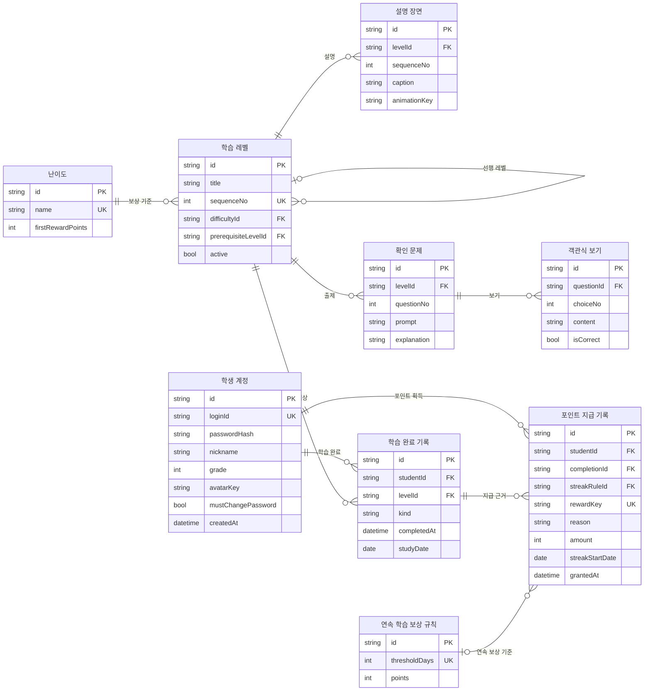

# 도형탐험대 논리 ERD 설계서

## 1. 설계 범위

**하나의 로컬 Java Swing 앱이 TXT/CSV 파일을 직접 읽고 쓴다.** 서버·클라이언트 저장소 구분 없는 통합 논리 모델이다. 9개 엔터티를 9개 CSV에 대응하는 안이며 DB 생성용 SQL이 아니다. PK는 행 식별자, FK는 다른 파일의 ID 참조, UK는 중복 금지 조건으로, Java 저장 모듈이 직접 검증한다.

학생은 반드시 계정으로 로그인한다. 해당 PC의 학생끼리 누적 포인트 랭킹을 비교한다. 중간 학습은 저장하지 않으며, 완료한 최초 학습과 복습을 저장한다. 계정·진행 상태를 이중으로 표현하던 서버/로컬 엔터티, 연결·전송대기·수신 엔터티는 제거했다.

## 2. 통합 ERD

그림의 속성은 CSV 헤더와 대응한다. string/int/bool/date/datetime은 논리 타입이며 실제 파일에는 텍스트로 직렬화한다. 관계의 최소 0은 빈 데이터 상태도 허용한다는 의미이며, 운영 가능한 레벨은 문제 개수 등 아래 제약을 추가로 만족해야 한다.



## 3. 엔터티·파일 사전

| 엔터티 | 의미 | CSV 열 |
|---|---|---|
| student | 학생 계정 | `id, loginId, passwordHash, nickname, grade, avatarKey, mustChangePassword, createdAt` |
| difficulty | 난이도 | `id, name, firstRewardPoints` |
| level | 학습 레벨 | `id, title, sequenceNo, difficultyId, prerequisiteLevelId, active` |
| lessonScene | 설명 장면 | `id, levelId, sequenceNo, caption, animationKey` |
| question | 확인 문제 | `id, levelId, questionNo, prompt, explanation` |
| answerChoice | 객관식 보기 | `id, questionId, choiceNo, content, isCorrect` |
| completion | 학습 완료 기록 | `id, studentId, levelId, kind, completedAt, studyDate` |
| streakRule | 연속 학습 보상 규칙 | `id, thresholdDays, points` |
| pointEntry | 포인트 지급 기록 | `id, studentId, completionId, streakRuleId, rewardKey, reason, amount, streakStartDate, grantedAt` |

| 엔터티 | 실제 파일명 제안 | 필수·선택 속성과 규칙 |
|---|---|---|
| student | students.csv | id는 변경하지 않는 식별자. loginId 유일·필수. passwordHash에 salt·방식·작업량 포함. nickname 필수, grade 선택(입력 시 1~6), avatarKey는 앱 내 기본 캐릭터 키. mustChangePassword 기본 false, 운영자 초기화 시 true 제안 |
| difficulty | difficulties.csv | BEGINNER/INTERMEDIATE/ADVANCED 및 초급/중급/고급, 50/100/150P. 기존 정책 변경 기능은 1차 범위 밖 |
| level | levels.csv | sequenceNo 유일. prerequisiteLevelId는 첫 레벨만 비움. difficultyId는 준비 중 비울 수 있으나 active=true 전 반드시 배정. 7레벨별 배정 미정 |
| lessonScene | lesson_scenes.csv | levelId 필수. sequenceNo는 같은 레벨 내 유일. caption 설명, animationKey는 앱에 포함된 애니메이션 정의 키. 실행 코드 문자열을 CSV에서 실행하지 않음 |
| question | questions.csv | levelId 필수. questionNo는 1~3. prompt 필수, explanation은 오답/정답 안내 |
| answerChoice | answer_choices.csv | questionId 필수. choiceNo는 같은 문제 내 유일, content 필수, isCorrect는 정답 여부 |
| completion | completions.csv | 완료했을 때만 생성. studentId·levelId 필수. kind=INITIAL 또는 REVIEW. completedAt과 studyDate 필수. 미완료 행은 없음 |
| streakRule | streak_rules.csv | S3:3일·20P, S7:7일·50P. 같은 연속 구간에서 각 한 번 |
| pointEntry | point_entries.csv | 학생·완료 근거 필수. reason=LEVEL_FIRST 또는 STREAK. amount는 실제 지급 금액 스냅샷. streakRuleId·streakStartDate는 STREAK일 때만 필수. grantedAt은 지급 확정 시각 |

createdAt·completedAt·grantedAt은 ISO 8601 오프셋 포함 시각, studyDate·streakStartDate는 YYYY-MM-DD. studyDate는 completedAt을 Asia/Seoul로 변환해 계산하며 임의 입력값으로 받지 않는다. id는 UUID 등 변경되지 않는 문자열을 제안한다.

### 파일 외 데이터와 메모리 상태

- `preferences.txt`: 아이디 기억 설정·마지막 기억 아이디. 비밀번호 저장 금지.
- `management_log.txt`: 운영자의 계정 발급/초기화 대상 ID·작업·시각·결과, 비밀번호 제외. 운영자 전용 계정 엔터티/화면은 새로 요구하지 않는다.
- `current.txt`: 완전히 저장된 파일 세대 이름. 파일 일관성을 위한 기술 설정으로 학습 ERD 엔터티가 아니다.
- 메모리: 현재 로그인 학생 ID, 진행 중 레벨, 설명 완료 여부, 문제별 정답 여부. 로그아웃·학습 중단·앱 종료 시 폐기한다. 미완료 시도와 개별 답안 파일을 만들지 않는다.
- 도형 이미지와 애니메이션 리소스는 프로그램에 포함한다. CSV에는 리소스 키를 저장한다.

## 4. 관계·유일 조건·무결성

| 관계 또는 조건 | 의미 |
|---|---|
| 학생 1 : 완료 0..N | 각 완료는 정확히 한 학생의 기록 |
| 레벨 1 : 완료 0..N | 각 완료는 정확히 한 레벨 |
| 레벨 1 : 장면/문제 0..N | 배포 가능한 레벨에는 설명 장면 1개 이상과 문제 정확히 3개 |
| 문제 1 : 보기 0..N | 사용 가능한 문제는 보기 2개 이상·정답 정확히 1개 |
| 난이도 1 : 레벨 0..N | 활성 레벨의 난이도는 정확히 한 개. 준비 중 미배정 허용은 사전의 예외 |
| 선행 레벨 0..1 : 후속 레벨 0..N | 첫 레벨 제외 선행 필수. 1차는 직선 순서. 순환 금지 |
| 완료 1 : 포인트 0..N | 보상 없는 복습은 0행, 최초 보상과 연속 보상을 동시에 받으면 여러 행 |
| 연속 규칙 0..1 : 포인트 0..N | 최초 레벨 보상에는 연속 규칙 없음 |
| UNIQUE(studentId, levelId) WHERE kind=INITIAL | 최초 완료는 학생·레벨당 한 번. CSV 검증 코드로 구현 |
| UNIQUE(levelId, sequenceNo) | 설명 장면 순서 중복 금지 |
| UNIQUE(levelId, questionNo) | 같은 레벨 문제 번호 중복 금지 |
| UNIQUE(questionId, choiceNo) | 보기 번호 중복 금지 |
| UNIQUE(rewardKey) | 동일 지급 근거 중복 금지 |

추가 검사:

1. 모든 ID는 해당 파일에서 유일하며, 빈 값이 허용되지 않는 참조는 실제 행을 가리켜야 한다.
2. completion은 로그인 학생에 귀속된다. 최초 완료 시 메모리의 설명 확인·3문제 정답·선행 완료를 검사한다. 복습은 해당 학생의 기존 INITIAL 완료와 현재 3문제 정답을 검사한다.
3. pointEntry.studentId는 completion.studentId와 같아야 한다. LEVEL_FIRST는 INITIAL 완료만 참조한다. 같은 최초 완료에 LEVEL_FIRST 행은 정확히 하나다.
4. STREAK는 해당 완료 날짜에 규칙 기준일이 달성되었는지 검증한다. 그 학생·구간·규칙에 대해 최대 한 행이다.
5. 완료 ID는 완료 저장 재시도 중 유지한다. 같은 ID를 이미 저장한 경우 새 완료로 삽입하지 않는다. 같은 ID인데 내용이 다른 경우 오류 처리한다.
6. 참조된 레벨·문제·보상 정책을 앱 실행 중 외부에서 수정하지 않는다. 1차 콘텐츠 확장은 새 레벨 ID를 추가하는 방식. 기존 문제 수정 이력·콘텐츠 버전 관리가 필요해지면 별도 설계한다.
7. 계정 삭제·완료 기록 수정·다른 PC 기록 가져오기는 확정 기능이 아니다. 참조 데이터를 임의 연쇄 삭제하지 않는다.

## 5. 포인트·캘린더·진도·랭킹

### 지급 기록의 두 유형

| reason | rewardKey 형식 | amount | 추가 필드 |
|---|---|---|---|
| LEVEL_FIRST | `FIRST:{studentId}:{levelId}` | 완료 당시 난이도 보상 50/100/150 | completionId 필수, streakRuleId·streakStartDate 비움 |
| STREAK | `STREAK:{studentId}:{streakStartDate}:{streakRuleId}` | 20 또는 50 | 기준일에 완료한 completionId 및 streakRuleId·streakStartDate 필수 |

rewardKey는 앱이 고정 포맷으로 생성하는 유일 문자열이다. 금액은 기록 시 저장하므로 이후 조회 때 난이도 값을 다시 곱하지 않는다. 복습은 LEVEL_FIRST 행을 만들지 않지만 해당 날이 3일/7일째라면 STREAK 행을 만들 수 있다.

이 키 설계는 **날짜 순으로 생성되는 정상 완료 기록, 과거 기록 가져오기/수정 없음**을 전제로 한다. PC 시계 역행이나 파일 수동 변경에 따른 구간 재편성·소급 정산 정책은 미정이다. 이를 자동 병합·재정산으로 해석하지 않는다. 역행을 감지하면 보상 자동 처리 대신 안내하는 안을 제안한다. 단순 파일 저장으로 시계/수동 편집 조작을 완전히 검증할 수 있다고 주장하지 않는다.

- 캘린더: completion에서 해당 학생의 studyDate를 중복 제거. 별도 달력 파일 없음.
- 최초 진도: 해당 학생의 INITIAL 완료와 활성 레벨 교집합 개수 / 활성 레벨 전체 개수.
- 잠금: prerequisiteLevelId에 대한 해당 학생의 INITIAL 완료 유무로 계산.
- 연속 구간: 중복 제거한 studyDate를 정렬하여 날짜 차이가 1인 구간을 계산. 3일/7일 각각 한 번 지급.
- 총 포인트: 해당 학생의 pointEntry.amount 합계. 기록이 없으면 0.
- 순위: 더 높은 총 포인트를 가진 학생 수 + 1. 같은 PC 학생 모두 포함, 동점 1·2·2·4.
- 프로필: student와 위 집계값을 사용. 닉네임은 중복 허용 설계안, 로그인 아이디는 유일.

캘린더·총 포인트·랭킹·최초 완료 요약은 조회 결과이며 별도 원본 파일을 중복 유지하지 않는다.

## 6. TXT/CSV 저장 계약 — 구현 설계안

- UTF-8, 첫 행은 고정 헤더. 쉼표 구분, 값에 쉼표·따옴표·줄바꿈이 있으면 CSV 인용 규칙 적용. 단순 split으로 읽지 않는다.
- bool은 true/false, 정수는 소수점 없는 텍스트. nullable 필드만 빈 칸 허용. 파일 형식 버전은 저장 세대의 manifest.txt에 기재한다.
- 앱 시작과 저장 직전에 파일 간 PK/FK/UK 및 업무 제약을 검사한다. 파일이 없거나 손상된 경우 기존 데이터를 초기화하지 않고 오류를 알린다. 최초 설치의 빈 학생 목록과 파일 손상을 구별한다.
- 학생·콘텐츠·완료·포인트 CSV를 하나의 활성 데이터 세트로 취급한다. 앱과 관리 도구 모두 같은 저장 모듈과 데이터 폴더를 사용한다.
- 저장은 새 세대 폴더에 전체 데이터 세트를 작성 → 파일 닫기·검증 → current.txt 교체 순서로 한다. 읽는 쪽은 current.txt가 가리키는 세대만 읽는다. 임시 세대를 섞어 읽지 않는다.
- 완료·포인트 묶음이 확정되기 전에는 완료 결과를 성공으로 표시하지 않는다. 실패 시 기존 세대 유지, 재시도에는 같은 완료 ID 사용.
- 이전 정상 세대를 백업으로 보존한다. current.txt 교체의 원자성·디스크 반영·충돌 및 강제 종료 복구는 실제 OS에서 검증한다. CSV 여러 개를 각각 rename하는 것만으로 묶음 저장이 보장된다고 보지 않는다.
- 동일 데이터 폴더에 단일 쓰기 잠금을 사용한다. 도구가 사용 중이면 앱의 변경을 차단하며 무조건 덮어쓰지 않는다.

예시 폴더 구성(실제 사용자 데이터 파일을 생성한 것은 아님):

```text
data/
  current.txt
  preferences.txt
  management_log.txt
  snapshots/
    generation-0001/
      manifest.txt
      students.csv
      difficulties.csv
      levels.csv
      lesson_scenes.csv
      questions.csv
      answer_choices.csv
      completions.csv
      streak_rules.csv
      point_entries.csv
```

## 7. 검수·미정 사항

검수: 9개 엔터티의 모든 참조 확인, 완료/포인트 중복 방지, 학생 간 기록 분리, 최초/복습 구분, 3일/7일 보상, 한국 날짜 경계, 동점 순위, 중간 학습 폐기, 파일 묶음 저장 중단 복구를 기능명세서 AC-01~20으로 검증한다. 본 문서는 설계 검토 결과이며 프로그램 실행 테스트 결과가 아니다.

미정: 초기 레벨별 난이도(사용자 결정 유보), 최종 학습 순서, 계정 관리 도구 형태·비밀번호 규칙, 백업 보존 기간, 시계 역행 처리 정책. 데이터 구조는 난이도 값을 추후 넣을 수 있으나 활성화 전 필수 검증한다.

