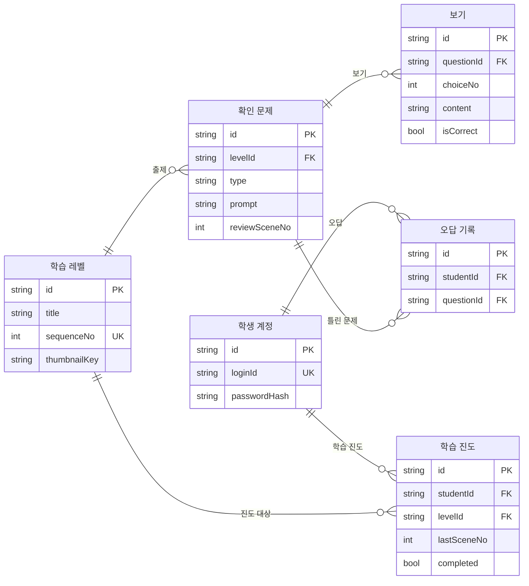

# 도형탐험대 논리 ERD 설계서 (A안: 핵심형)

> **v2 보완 (11/7 확정용)** — 팀 제안서 기능(오답 → 애니메이션 복습 연결, 오답 복습, 약점 단원 추천, 단원 썸네일)에 필요한 데이터를 추가했다. 바뀐 곳은 본문에 **[v2]**로 표시했다.
>
> | 구분 | 변경 내용 | 이유 (제안서 기능) |
> |---|---|---|
> | 엔터티 추가 | `wrongAnswer`(오답 기록) → `wrong_answers.csv` | 오답 복습, 약점 단원 추천, 12주차 오답노트 txt |
> | 속성 추가 | `question.reviewSceneId` (FK → lessonScene) | 틀린 문제를 해당 애니메이션 장면으로 연결 |
> | 속성 추가 | `level.thumbnailKey` | 단원 목록 썸네일 이미지 |
> | 규칙 변경 | 개별 답안 중 **오답만** 즉시 저장 (3장 메모리 항목) | 학습을 중간에 그만둬도 틀린 문제가 오답노트에 남아야 함 |
> | 구현 순서 | 8장 추가 (1차/2차 범위) | 데이터 담당 1명 기준 일정 |

## 1. 설계 범위

**하나의 로컬 Java Swing 앱이 TXT/CSV 파일을 직접 읽고 쓴다.** 6개 엔터티를 6개 CSV에 대응하는 안이며 DB 생성용 SQL이 아니다. PK는 행 식별자, FK는 다른 파일의 ID 참조, UK는 중복 금지 조건으로, Java 저장 모듈이 직접 검증한다.

A안은 핵심 항목만 담는다.

| 확인된 핵심 항목 | 엔터티 |
|---|---|
| 학생 계정 (아이디, 비밀번호) | student |
| 레벨 (순서, 제목, 썸네일) | level |
| 문제 (어느 레벨, 유형, 문제, 정답, 복습 장면), 보기 | question, answerChoice |
| 학습 기록: 완료한 레벨 / 어디까지 봤는지 / 오답 | progress, wrongAnswer |

학생은 반드시 계정으로 로그인한다. 설명 장면(세부페이지)의 내용은 앱에 포함하며 CSV로 관리하지 않는다. 따라서 진도와 복습 위치는 장면 순서 번호로 저장한다. 난이도, 포인트·연속 학습 보상, 랭킹, 닉네임 등 부가 기능은 B안에서 엔터티를 추가하는 방식으로 확장한다.

## 2. 통합 ERD

그림의 속성은 CSV 헤더와 대응한다. string/int/bool은 논리 타입이며 실제 파일에는 텍스트로 직렬화한다. 관계의 최소 0은 빈 데이터 상태도 허용한다는 의미다.

## 3. 엔터티·파일 사전

| 엔터티 | 의미 | CSV 열 |
|---|---|---|
| student | 학생 계정 | `id, loginId, passwordHash` |
| level | 학습 레벨 | `id, title, sequenceNo, thumbnailKey` |
| question | 확인 문제 | `id, levelId, type, prompt, reviewSceneNo` |
| answerChoice | 보기 | `id, questionId, choiceNo, content, isCorrect` |
| progress | 학습 진도 | `id, studentId, levelId, lastSceneNo, completed` |
| wrongAnswer | 오답 기록 | `id, studentId, questionId` |

| 엔터티 | 실제 파일명 제안 | 필수·선택 속성과 규칙 |
|---|---|---|
| student | students.csv | id는 변경하지 않는 식별자. loginId 유일·필수. passwordHash에 salt·방식·작업량 포함 |
| level | levels.csv | title 필수. sequenceNo 유일하며 단원 목록 정렬과 잠금 판단에 사용. thumbnailKey는 단원 목록 카드의 도형 그림 리소스 키 |
| question | questions.csv | levelId 필수. type=OX 또는 MULTIPLE_CHOICE. prompt 필수. reviewSceneNo는 틀렸을 때 다시 볼 같은 레벨의 설명 장면 순서 번호 |
| answerChoice | answer_choices.csv | questionId 필수. choiceNo는 같은 문제 내 유일, content 필수, isCorrect는 정답 여부. OX 문제는 보기 O·X 두 개로 표현 |
| progress | progress.csv | 학생·레벨당 한 행. studentId·levelId 필수. lastSceneNo는 마지막으로 본 설명 장면 순서 번호. completed는 레벨 완료 여부, 기본 false |
| wrongAnswer | wrong_answers.csv | 틀린 문제를 기록한다. studentId·questionId 필수. 오답노트에서 다시 맞히면 해당 행을 삭제한다 |

id는 UUID 등 변경되지 않는 문자열을 제안한다.

## 4. 관계·유일 조건·무결성

| 관계 또는 조건 | 의미 |
|---|---|
| 레벨 1 : 문제 0..N | 각 문제는 정확히 한 레벨에 속한다 |
| 문제 1 : 보기 0..N | 사용 가능한 문제는 보기 2개 이상·정답 정확히 1개 |
| 학생 1 : 진도 0..N | 각 진도는 정확히 한 학생의 기록 |
| 레벨 1 : 진도 0..N | 각 진도는 정확히 한 레벨 |
| 학생 1 : 오답 0..N | 각 오답은 정확히 한 학생의 기록 |
| 문제 1 : 오답 0..N | 각 오답은 정확히 한 문제 |
| UNIQUE(questionId, choiceNo) | 보기 번호 중복 금지 |
| UNIQUE(studentId, levelId) | 진도는 학생·레벨당 한 행 |
| UNIQUE(studentId, questionId) | 오답은 학생·문제당 한 행 |

추가 검사:

1. 모든 ID는 해당 파일에서 유일하며, 빈 값이 허용되지 않는 참조는 실제 행을 가리켜야 한다.
2. progress와 wrongAnswer는 로그인 학생에 귀속된다.
3. question.reviewSceneNo와 progress.lastSceneNo는 1 이상, 해당 레벨의 설명 장면 수 이하여야 한다.
4. OX 문제의 보기는 O·X 두 개이며 그중 하나만 isCorrect=true.

## 5. 진도·잠금·오답노트

- 단원 목록: level을 sequenceNo 순으로 표시하고, 해당 학생의 progress.completed로 완료를 표시.
- 잠금: 앞 sequenceNo 레벨의 progress.completed=true면 열림. 첫 레벨은 항상 열림.
- 이어 보기: progress.lastSceneNo 장면부터 시작.
- 오답노트: 해당 학생의 wrongAnswer 목록. 항목을 누르면 question.reviewSceneNo 장면으로 이동하고, 다시 맞히면 행을 삭제한다.

진도율·잠금·오답노트는 조회 결과이며 별도 원본 파일을 중복 유지하지 않는다.

## 6. TXT/CSV 저장 계약

- UTF-8, 첫 행은 고정 헤더. 쉼표 구분, 값에 쉼표·따옴표·줄바꿈이 있으면 CSV 인용 규칙 적용. 단순 split으로 읽지 않는다.
- bool은 true/false, 정수는 소수점 없는 텍스트. nullable 필드만 빈 칸 허용.
- 앱 시작과 저장 직전에 파일 간 PK/FK/UK 및 업무 제약을 검사한다. 파일이 없거나 손상된 경우 기존 데이터를 초기화하지 않고 오류를 알린다. 최초 설치의 빈 학생 목록과 파일 손상을 구별한다.

## 7. 검수·미정 사항

검수: 6개 엔터티의 모든 참조 확인, 학생 간 기록 분리, 잠금 계산, 오답 기록·삭제를 검증한다. 본 문서는 설계 검토 결과이며 프로그램 실행 테스트 결과가 아니다.

미정: 최종 학습 순서, 계정 관리 방식·비밀번호 규칙.

B안 확장 시 추가: difficulty(난이도), pointEntry(포인트 지급), streakRule(연속 학습 보상 규칙), lessonScene(설명 장면, 내용을 CSV로 관리할 경우), student.nickname(랭킹 표시).
